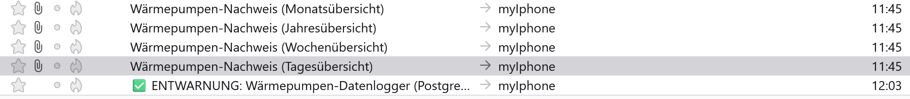
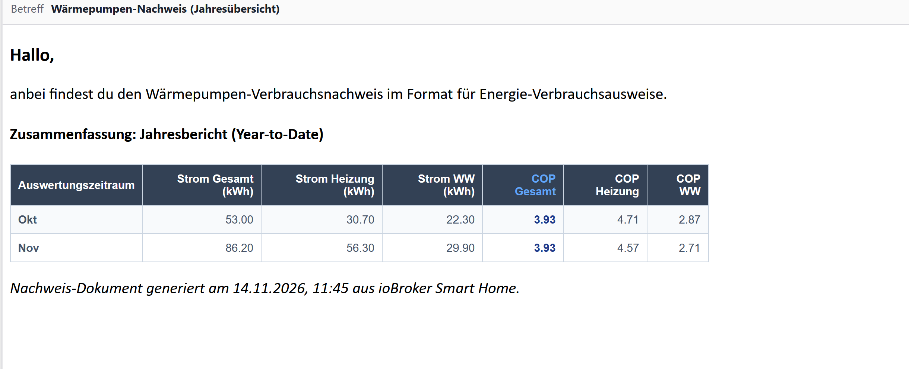
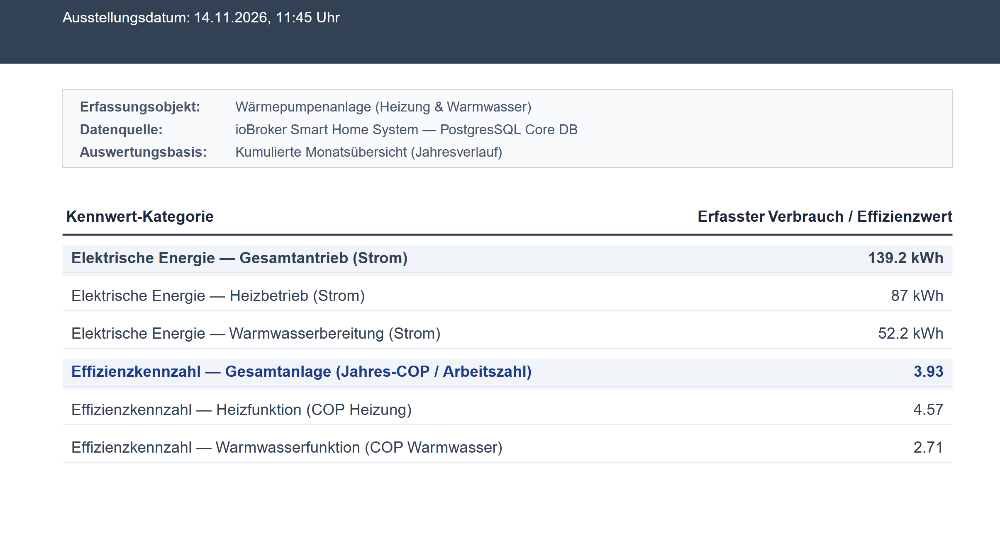
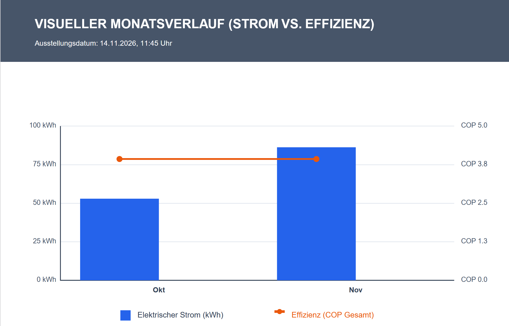
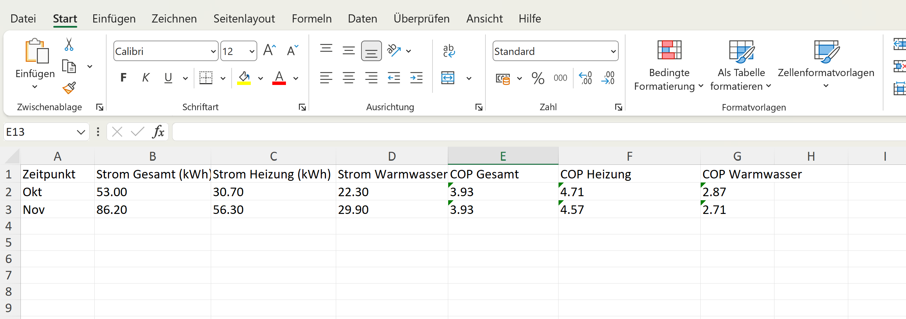

# ioBroker Novelan / Luxtronic – PostgreSQL Energie- und Wärmemengenzähler

Dieses Projekt erfasst elektrische Verbräuche (kWh) und erzeugte Wärmemengen (kWh) einer **Novelan / Alpha Innotec (Luxtronic 2.0/2.1)** Wärmepumpe über **ioBroker**, speichert die Zählerstände ausfallsicher in einer **PostgreSQL- / TimescaleDB-Datenbank** und generiert automatisierte **Verbrauchs- und Effizienznachweise (COP / JAZ)** als **Excel-Tabelle (.xlsx)**, **PDF-Dokument (.pdf)** und **HTML-E-Mail**.

---

## ✨ Funktionen

### 1. Automatisches Datenpunkt-Setup (`scripts/00_create_datapoints.js`)
* **Ein-Klick-Anlage:** Erstellt automatisch alle 7 benötigten `0_userdata.0`-Datenpunkte für Strompreis, Stromverbräuche und Wärmemengen inklusive Einheiten (`kWh` / `€/kWh`) und beendet sich danach selbst.

### 2. Ausfallsicherer PostgreSQL-Datenlogger (`scripts/01_data_logger.js`)
* **RAM-Pufferung:** Überwacht die ioBroker-Datenpunkte in Echtzeit und hält die aktuellen Zählerstände im Arbeitsspeicher.
* **Zyklische Speicherung:** Schreibt alle 5 Minuten über einen stabilen `pg.Pool` in die PostgreSQL-Tabelle `heat_pump`.
* **Monitoring & Alarmierung:** Sendet automatisch eine **Entwarnungs-Mail** beim Skriptstart und eine **Alarm-Mail**, falls das Skript gestoppt oder neu gestartet wird.

### 3. Automatisierter GEG-Verbrauchsnachweis (`scripts/02_geg_reports.js`)
* **4 Auswertungszeiträume:**
  * **Täglich (23:59 Uhr):** Rückblick der letzten 24 Stunden.
  * **Wöchentlich (Sonntag, 23:55 Uhr):** Week-to-Date Auswertung.
  * **Monatlich (Monatsletzter, 23:50 Uhr):** Month-to-Date Auswertung.
  * **Jährlich (Monatsletzter, 23:50 Uhr):** Year-to-Date Monatsverlauf inklusive **Kombi-Balken-/Liniendiagramm** (Stromverbrauch vs. COP) im PDF.
* **Multi-Format-Export:** Speichert Excel- und PDF-Dateien lokal auf dem Server und versendet sie direkt per E-Mail.

---

## 📸 Vorschau & Auswertungsbeispiele

### 1. Automatisierter E-Mail-Versand & Monitoring


### 2. HTML-Zusammenfassung (Beispiel: Jahresbericht)


### 3. PDF-Verbrauchsnachweis (GEG-Format) & Jahresdiagramm

| Verbrauchs- & Effizienznachweis (Seite 1) | Visueller Monatsverlauf (Seite 2) |
| :---: | :---: |
|  |  |

### 4. Excel-Export (.xlsx)


---

## 🐳 Schnellstart mit Docker (All-in-One Stack)

Im Ordner [`docker/`](docker/) liegt eine fertige `docker-compose.yml`, mit der du die komplette Infrastruktur in wenigen Minuten starten kannst:
* **ioBroker** (`buanet/iobroker`) – Port `8081` (Host-Netzwerk für Luxtronic-Erkennung)
* **PostgreSQL 16 + TimescaleDB** (`timescale/timescaledb`) – Port `5432` (legt die Tabelle `heat_pump` beim Start automatisch an)
* **pgAdmin 4** (`dpage/pgadmin4`) – Weboberfläche unter `http://SERVER-IP:8085`
* **Eclipse Mosquitto MQTT** (`eclipse-mosquitto`) – Port `1883`

### Stack starten
1. Passe in der Datei [`docker/docker-compose.yml`](docker/docker-compose.yml) die Platzhalter-Passwörter (`DEIN_SICHERES_PASSWORT` und `DEIN_PGADMIN_PASSWORT`) an.
2. Starte alle Container im Hintergrund:
   ```bash
   cd docker
   docker compose up -d
   ```
3. Öffne ioBroker unter `http://SERVER-IP:8081` und pgAdmin unter `http://SERVER-IP:8085`.

---

## 🛠️ Voraussetzungen (bei manueller Installation)

1. **ioBroker** mit installiertem **JavaScript-Adapter** (`javascript.0`) und **E-Mail-Adapter** (`email.0`).
2. **Novelan / Luxtronic Adapter** (z. B. `luxtronik2` oder eigene Skripte, welche die `0_userdata.0`-Zählerstände befüllen).
3. **PostgreSQL Datenbank** (z. B. PostgreSQL 14+ auf Linux / Raspberry Pi / Proxmox).
4. **Zusätzliche NPM-Module** in den Einstellungen des ioBroker JavaScript-Adapters eintragen:
   ```text
   pg, xlsx, pdfkit
   ```

---

## 🚀 Installation & Einrichtung in ioBroker

### Schritt 1: PostgreSQL-Tabelle anlegen
*(Bei Nutzung des Docker-Stacks wird dieser Schritt beim ersten Start automatisch ausgeführt.)*  
Führe das Skript [`sql/create_table.sql`](sql/create_table.sql) in deiner PostgreSQL-Datenbank (z. B. über pgAdmin oder `psql`) aus, um die Tabelle `heat_pump` samt Zeitstempel-Index zu erstellen.

### Schritt 2: ioBroker-Datenpunkte anlegen (`scripts/00_create_datapoints.js`)
1. Lege im ioBroker unter `Skripte` ein neues JavaScript an und füge den Code aus [`scripts/00_create_datapoints.js`](scripts/00_create_datapoints.js) ein.
2. Starte das Skript einmalig – alle benötigten `0_userdata.0`-Datenpunkte werden automatisch erstellt und das Skript beendet sich danach selbst.

### Schritt 3: Speicherordner auf dem ioBroker-Host anlegen
*(Bei Nutzung des Docker-Stacks ist das Volume `./auswertungen:/auswertungen` bereits vorkonfiguriert.)*  
Erstelle auf deinem ioBroker-Server die Zielverzeichnisse für Excel und PDF (mit Schreibrechten für den User `iobroker`):
```bash
sudo mkdir -p /auswertungen/postgresSQL/excel /auswertungen/postgresSQL/pdf
sudo chown -R iobroker:iobroker /auswertungen
```

### Schritt 4: Datenlogger einrichten (`scripts/01_data_logger.js`)
1. Lege ein weiteres JavaScript an und füge den Code aus [`scripts/01_data_logger.js`](scripts/01_data_logger.js) ein.
2. Passe oben im Skript deine PostgreSQL-Zugangsdaten sowie deine E-Mail-Adresse an.
3. Starte das Skript – du erhältst sofort eine Bestätigungs-Mail und der erste Datensatz wird geschrieben.

### Schritt 5: Berichtsgenerator einrichten (`scripts/02_geg_reports.js`)
1. Lege ein drittes JavaScript an und füge den Code aus [`scripts/02_geg_reports.js`](scripts/02_geg_reports.js) ein.
2. Trage auch hier deine PostgreSQL-Verbindungsdaten, deine Adresse für den PDF-Briefkopf sowie deine E-Mail-Adresse ein.
3. Nutze zum Testen `const SOFORT_TESTEN = "daily";` (oder `"all"`) und setze den Wert nach erfolgreichem Test wieder auf `""`.

---

## 📄 Lizenz
Dieses Projekt steht unter der **MIT-Lizenz** – freie Nutzung und Anpassung für dein eigenes Smart Home!
